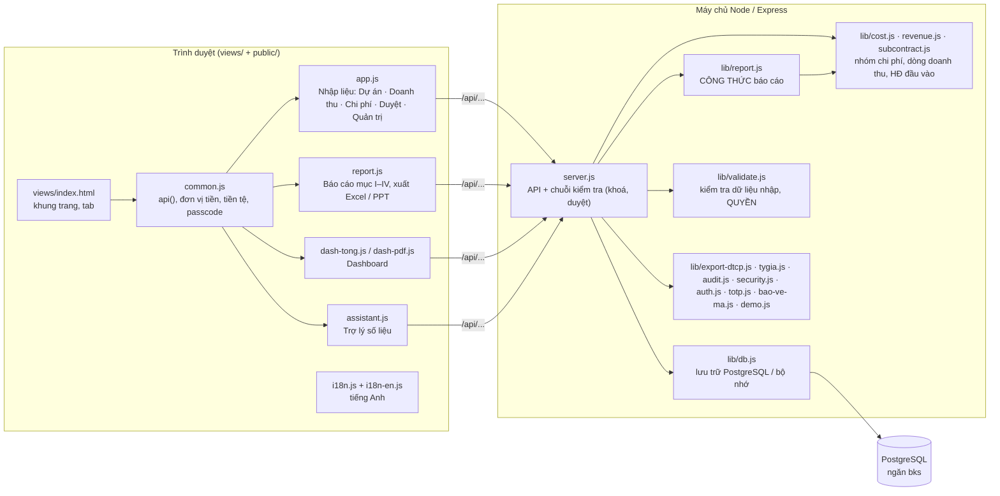
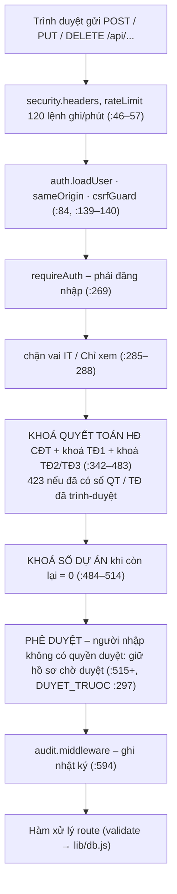

# SƠ ĐỒ CẤU TRÚC CODE – Hệ thống BKS (Quản lý hiệu quả dự án)

> Cập nhật: 27/11/2026 · bản V08.27.11.26 · nhánh `staging`. Dùng để tra cứu khi sửa lỗi thủ công.
> Số dòng trong tài liệu là số dòng tại bản này. Sau khi sửa mã, chạy lại công cụ ở mục 10 để cập nhật.

---

## 1. Toàn cảnh



| Lớp | Tệp | Vai trò |
|---|---|---|
| Giao diện | `views/index.html` | Khung trang: thanh trên, tab Báo cáo / Duyệt / Nhập liệu / Quản trị / Hướng dẫn, các khung trống mà JS đổ dữ liệu vào |
| | `public/common.js` | Dùng chung: `api()`, `$`/`$$`, đơn vị tiền (`DV`, `dvNum`, `dvU`), tiền tệ VND/USD/EUR (`tienNgoai`, `tienRate`), ô tiền (`parseMoney`, `magicSo`), hộp Passcode (`askPasscode`) |
| | `public/app.js` | Toàn bộ trang Nhập liệu + Duyệt + Quản trị (~4.900 dòng) |
| | `public/report.js` | Trang Báo cáo + xuất Excel / PowerPoint (~2.900 dòng) |
| | `public/dash-tong.js`, `dash-pdf.js` | Dashboard và Dashboard PDF |
| Máy chủ | `server.js` | Tất cả API, chuỗi kiểm tra trước khi ghi, gom số cho trang |
| | `lib/report.js` | **Công thức tiền**: doanh thu / chi phí / lợi nhuận theo TĐ, dòng tiền, tình trạng, còn lại |
| | `lib/db.js` | Đọc / ghi dữ liệu: PostgreSQL (`bks`) hoặc bộ nhớ tạm khi chạy thử |
| | `lib/validate.js` | Kiểm tra dữ liệu nhập + bảng QUYỀN theo vai trò |

---

## 2. Một lệnh ghi đi qua những bước nào (`server.js`)

Thứ tự kiểm tra từ trên xuống. Bước nào chặn thì dừng ở đó (mã 4xx).



* **Khoá** do cài đặt Passcode trong Quản trị › Cài đặt mở; hàm `requirePasscode`.
* **Duyệt:** Quản trị / Lãnh đạo ghi ngay; vai khác → hồ sơ ở trang Duyệt, khi duyệt máy chủ "chạy lại" lệnh với `req.noiBo`.

---

## 3. Dữ liệu (ngăn `bks`, `lib/db.js` – chỉ THÊM cột, không xoá / đổi tên)

| Bảng | Nội dung | Cột hay dùng |
|---|---|---|
| `du_an` | Dự án | `ma_du_an`, `trang_thai`, `pt_gt1/2`, `pt_tc1/2` (dự trù nhanh cũ), `td1_* td2_* td3_*` (trình / duyệt / khoá TĐ) |
| `doanh_thu` | HĐ / PL chủ đầu tư (`loai='hd'`), đợt HT/QT (`loai='qt'`) | `so_ma`, `ma_loai` (HĐ, PL01…), `gia_tri`, `vat`, `gt_qt`, `qt_dong` |
| `tien_ve` | Tiền CĐT trả | `hd_id`, `loai` (tạm ứng / đợt / QT), `so_tien`, `ngay` |
| `tp_hop_dong` | HĐ đầu vào (thầu phụ, vật tư, NC, MMTB) | `nhom`, `goi_id` (gắn gói), `phat_sinh`, `hd_cdt_id` |
| `tp_hd_pl` | Dòng HĐ / PL của HĐ đầu vào | `gia_tri`, `gia_tri_qt`, `td_ps` (phát sinh tại TĐ), `la_cp` (CP khác cũ) |
| `tp_thanh_toan` | Trả tiền HĐ đầu vào | |
| `dieu_chinh` | Đợt điều chỉnh TĐ2 của 1 HĐ / PL (doanh thu hoặc đầu vào) | `loai` ('dt' / 'tp'), `vb_id`, `so_tien` |
| `du_tru` | **Dự trù chi phí** | `loai`: `ky` = gói / khoản (TĐ1) · `dc` = đợt điều chỉnh TĐ2 · `qt` = quyết toán nhóm<br/>`goi_ref` (đợt gắn gói), `tinh_trang` ('dong' = đóng gói), `gt_chot` (số chốt TĐ3), `dtcp` (dòng nhập ở bảng DT-CP), `nhom_con` (hạng mục: Vật tư chính/phụ, Lương/Thưởng…), `td_ps` (phát sinh tại TĐ2/3), `la_cp` (CP khác của nhóm) |
| `chi_phi` | Khoản đã chi thật / mua lẻ | `nhom`, `nhom_con`, `goi_id` (gắn gói / khoản), `td_ps` |
| `du_an_thoi_diem` | Số chốt TĐ nhập tay (cũ) | |
| `users`, `sessions`, `settings`, `nhat_ky`, `duyet`, `sao_luu`… | Tài khoản, phiên, cài đặt (passcode, tỷ giá `ty_gia_vcb`), nhật ký, hồ sơ duyệt, sao lưu | |

Nhóm chi phí và hạng mục con: `lib/cost.js` (`NHOM_CHI_PHI`, khối B1 trực tiếp · B2 gián tiếp · B3 tài chính).

---

## 4. Bản đồ CÔNG THỨC (nơi ra từng con số)

> ⚠ Có những phép tính **làm ở cả máy chủ lẫn giao diện** (giao diện tính để hiện ngay, máy chủ tính cho báo cáo). **Sửa một bên thì phải sửa bên kia**, rồi chạy `scripts/kiem-tra-them/doi-chieu-cp.js`.

### 4.1 Doanh thu theo TĐ – `lib/report.js` `projectReport0`, `tdLine`
* **TĐ1** = giá trị ký HĐ + PL · **TĐ2** = TĐ1 ± các đợt điều chỉnh (`dieu_chinh`) · **TĐ3** = số quyết toán từng văn bản (`gt_qt`); văn bản chưa có số thì lấy TĐ2.

### 4.2 Chi phí theo TĐ = HĐ đầu vào + chi phí đã ghi + dự trù

| Phần | Máy chủ (`lib/report.js`) | Giao diện (`public/app.js`) – phải khớp |
|---|---|---|
| HĐ đầu vào từng dòng: TĐ1 ký, TĐ2 = TĐ1 ± đợt, TĐ3 = QT; dòng phát sinh TĐ2/3 (`td_ps`) → TĐ trước = 0; HĐ gắn gói / phát sinh → TĐ1 = 0 | `tpLine`, `tpTd` | `tpLV`, `tpTdSv` |
| Chi phí đã ghi: tính từ TĐ `td_ps` của dòng; **chi gắn khoản phát sinh TĐ sau → cũng từ TĐ đó** | đầu `projectReport0` (gán td_ps hiệu lực), `cpTdNhom0` | thẻ tổng `costKpiTd › tai`, `dtcpCon` |
| **Dự trù / gói / khoản** (`du_tru`) – xem 4.3 | `duTruNhom`, `goiV` (theo HĐ CĐT) | `dtrRem` (+`dtrHd`) dùng chung cho: bảng DT-CP (`dtcpHtml`, `dtcpCon`), thẻ tổng (`tai`), hộp HĐ › (`renderTpCard` / `goiSv`, `nhomSv`, `nhomSvB`), hộp gói theo nhóm (`dtrTd`), danh sách khoản (`ptKhoan`) |
| Gián tiếp / tài chính theo % doanh thu (dự trù nhanh cũ) | `cp_khoi`, `pt_td` (server.js `/du-an/:id/chi-phi`) | dòng "Dự trù nhanh (số cũ)" + nút Bỏ |

### 4.3 Quy tắc dự trù (`duTruNhom` ↔ `dtrRem`)
1. **TĐ1** = giá trị gói / khoản (khoản phát sinh TĐ2/TĐ3 = 0).
2. **Gói còn mở** ở TĐ2/TĐ3 = **MAX(gói ± đợt điều chỉnh của gói, HĐ đã gắn + mua lẻ đã gắn)**; **đóng gói** → chỉ còn HĐ + mua lẻ thật.
3. **Dự trù chung** của 1 hạng mục (dòng nhập ở bảng DT-CP, `dtcp`) = **phần còn lại** sau các khoản / gói chi tiết cùng hạng mục → hạng mục = MAX(chung, tổng chi tiết), ở TĐ1 và TĐ2. Hạng mục xác định bằng `conOf` / `dtcpConOf` (cột `nhom_con`, khoản cũ đoán theo tên).
4. **CP khác** (`la_cp`) luôn cộng thêm; có số chốt TĐ3 → TĐ3 = số chốt.
5. **Gián tiếp / tài chính (B2, B3) TĐ3** = số chốt từng khoản, chưa chốt = tiền đã chi gắn khoản.
6. **Đợt điều chỉnh không gắn gói** ("Điều chỉnh cả nhóm") cộng thẳng vào nhóm.
7. **Quyết toán cả nhóm** (`loai='qt'`) → TĐ3 nhóm = số quyết toán.

### 4.4 Các số trên Báo cáo – `public/report.js`
| Mục | Hàm | Nguồn |
|---|---|---|
| I. Doanh thu – Chi phí – Lợi nhuận theo TĐ | `bTongHopData`, `bTongHopHtml` | `/api/bao-cao` (`reportProjects` → `projectReport`) |
| II. Dòng tiền thực tế | `bThuc`, `bSeries` | `tien_thuc` (tiền về, chi đã ghi, trả HĐ đầu vào) |
| III. Còn lại phải thu – chi | `bMuc3Data` | DT / CP mới nhất − dòng thu / chi |
| IV. Doanh thu hoàn thành – quyết toán | `bMuc4Data` | `moc` (c1/c2/c3 = chi phí TĐ1/2/3) |
| Dòng "Tình trạng" đầu báo cáo, khoá số | `bGhiChuNhanh`, `bKhoaIc` | `con_lai` (`lib/report.js conLai`) |
| Đổi tiền USD / EUR | `bn`, `bTyFix`, `XK`, `XUT` + `common.js tienNgoai` | `/api/ty-gia` (`lib/tygia.js`, Vietcombank) |

---

## 5. Màn hình → hàm chính

| Màn hình / thao tác | Hàm (tệp) |
|---|---|
| Đổi tab | `showTab` (app.js) |
| Trang Dự án | `loadProjects…` (app.js, đầu tệp) |
| Trang Doanh thu (HĐ/PL, HT/QT, tiền về, TĐ1/2/3) | `loadRevenueTab`, `loadRevenue`, `renderTdMode`, `openDc` (đợt điều chỉnh), `openQtDt` |
| Trang Chi phí – khung nhập | `loadCostTab`, `loadCost`, `costKpiTd` (thẻ tổng + khung nhập) |
| Bảng DT-CP TĐ1/2/3 | `dtcpHtml`, `dtcpTinh` (tính khi gõ), lưu: nút "Lưu bảng" (TĐ1), `dtcpLuuTd2` (TĐ2 số cuối) |
| Thanh Trình / Duyệt / Khoá TĐ | `tdBar`, `tdInfo` ; máy chủ `tdDuyetHandler` (`/du-an/:id/td/:k`) |
| Nút **HĐ ›** (khối trực tiếp) | `renderTpCard` (tính `TPV`), `openTpNhom` / `renderTpNhom` (hộp nhóm: + HĐ, + CP khác, Gộp vào gói) |
| Hộp 1 HĐ đầu vào (PL, điều chỉnh, QT, thanh toán) | `openTp`, `renderTpDlg`, `onTpTableClick` |
| Nút **Chi tiết ›** (lương, thưởng…) | `openKhoanDs` → `openKhoan` (1 khoản) |
| Hộp CP khác | `openCpk` |
| Lịch sử nhóm / gói theo nhóm | `openDtr`, `renderDtr`, `dtrTd` |
| ＋ Ghi khoản đã chi | `moFormChi` (hộp chứa form `#c-form`), lưu `saveCost` |
| Trang Duyệt | `loadDuyet`, `veTd1Duyet` (TĐ1–TĐ3 chờ duyệt) |
| Báo cáo / Dashboard | `loadReport`, `renderReport` (report.js) ; `bDashRender` (dash-tong.js) |
| Xuất Excel / PPT / PDF | report.js mục Excel (`xlTable`, `xlForm`), `b-pptx`, `dash-pdf.js` ; Excel mẫu: máy chủ `lib/export-dtcp.js` |
| Đơn vị / tiền tệ, ngôn ngữ, sáng tối | `caiDv`, `taiTyGia` (app.js) · `i18n.js` · `theme.js` |

---

## 6. Kiểm thử (chạy khi sửa)

Cách chạy: `npm start` (không có DATABASE_URL = bộ nhớ tạm) → Quản trị › Cài đặt › Tạo dữ liệu mẫu, rồi:

| Lệnh | Kiểm gì |
|---|---|
| `node scripts/tester.js <url> admin <mk>` | ~4.500 đối chiếu số báo cáo |
| `node scripts/kiem-tra-goi.js <url> admin <mk>` | gói, HĐ đầu vào, khoá, trình duyệt TĐ1 |
| `BKS_PASS=<mk> BKS_PC=<passcode> node scripts/kiem-tra-them/<tên>.js` | `doi-chieu-cp` (máy chủ = thẻ tổng = báo cáo mục IV) · `td23` (trình/duyệt/khoá TĐ2-3) · `td2-socuoi` (bảng TĐ2 số cuối, gói MAX) · `du-tru-chung` · `luong` · `chi-tiet-khoan` · `cp-khac` · `nhom-ps` · `tdk` · `dcA` · `duyet` · `khoa-du-an`… |

Lưu ý: giới hạn 120 lệnh ghi/phút → khởi động lại máy chủ hoặc chờ 1 phút giữa các bài.

---

## 7. Kết quả rà soát 27/11/2026

| Hạng mục | Kết quả |
|---|---|
| Đường dẫn giao diện ↔ máy chủ | 103 đường dẫn; mọi lệnh gọi từ giao diện đều có đường dẫn máy chủ tương ứng. `/su-kien-thu` là đường thử kết nối tức thì (công khai, không có số liệu) – giữ |
| Hàm thừa | Gỡ 20 hàm + 6 biến không còn dùng (~310 dòng): phần còn lại của khu "Báo cáo theo công trình", bản đồ, hiệu ứng số chạy, mẫu form cũ |
| Công thức | Đối chiếu 3 nơi tính chi phí (máy chủ / thẻ tổng / báo cáo mục IV) cho mọi dự án mẫu + dự án có đủ tình huống mới: **109/109 khớp** |
| Giao diện | Dò mọi tab × TĐ1–3, Báo cáo / Dashboard, các hộp (HĐ ›, Chi tiết ›, Lịch sử, Ghi khoản đã chi), xuất Excel / Excel mẫu / PPT: không lỗi trang, không "NaN / undefined", không tràn (máy tính + iPhone) |
| Lỗi đã sửa trong ngày | Dự trù chung cộng dồn với khoản chi tiết · chi gắn khoản phát sinh TĐ3 tính lùi TĐ trước · trùng tên khi làm rối mã (có thể làm trang lỗi ngẫu nhiên) |

### Đề xuất tinh gọn tiếp (chưa làm – cần quyết)
1. **Gom công thức dự trù về 1 chỗ:** giao diện hiện có 5 nơi gọi `dtrRem` theo cách hơi khác (bảng, thẻ tổng, hộp HĐ ›, hộp gói, danh sách khoản). Cho máy chủ trả sẵn số từng gói / khoản theo TĐ → giao diện chỉ hiển thị. Giảm hẳn nguy cơ lệch.
2. **Tách `public/app.js` (~4.900 dòng)** thành các tệp theo trang: `nhap-du-an.js`, `nhap-doanh-thu.js`, `nhap-chi-phi.js`, `duyet.js`, `quan-tri.js`.
3. **Bỏ hẳn các chức năng cũ còn giữ để đọc số cũ:** "Dự trù nhanh %", "Chi phí khác" dạng phụ lục HĐ thầu phụ, "Điều chỉnh cả nhóm" – sau khi đã chuyển hết số liệu cũ.
4. **Gom 3 loại khoá** (khoá QT HĐ, khoá TĐ, khoá số dự án) về một bảng quy tắc chung trong `server.js`.

---

## 8. Quy ước khi sửa
* Chỉ làm trên nhánh `staging`; mỗi lần lưu: `node scripts/bump-version.js`, chạy kiểm thử, cập nhật `docs/TOM-TAT-PHIEN.md`.
* Kho dữ liệu: chỉ THÊM (`ADD COLUMN IF NOT EXISTS`), đặt lệnh thêm cột **sau** lệnh tạo bảng.
* Thêm chữ giao diện → thêm câu dịch vào `public/i18n-en.js`.
* Mã giao diện được rút gọn + làm rối lúc máy chủ khởi động (`lib/bao-ve-ma.js`) → sửa xong phải **khởi động lại máy chủ** mới thấy.

---

## 9. Danh sách đường dẫn API (server.js)

| Lệnh | Đường dẫn | Dòng |
|---|---|---|
| GET | `/health` | 64 |
| GET | `/` | 115 |
| GET | `/login` | 120 |
| GET | `/setup` | 125 |
| GET | `/api/ty-gia` | 143 |
| GET | `/api/meta` | 144 |
| POST | `/api/setup` | 167 |
| POST | `/api/auth/login` | 191 |
| POST | `/api/auth/logout` | 254 |
| POST | `/api/auth/away` | 263 |
| GET | `/api/duyet/dem` | 598 |
| GET | `/api/duyet` | 604 |
| GET | `/api/duyet/nhan` | 614 |
| POST | `/api/duyet/xu-ly` | 616 |
| GET | `/su-kien-thu` | 644 |
| GET | `/api/duyet/su-kien` | 651 |
| POST | `/api/duyet/huy` | 661 |
| POST | `/api/nhat-ky/su-kien` | 680 |
| GET | `/api/nhat-ky` | 686 |
| GET | `/api/auth/me` | 700 |
| GET | `/api/auth/2fa` | 704 |
| POST | `/api/auth/2fa/tao` | 708 |
| POST | `/api/auth/2fa/bat` | 716 |
| POST | `/api/auth/2fa/tat` | 725 |
| POST | `/api/auth/change-password` | 737 |
| GET | `/api/settings` | 752 |
| PUT | `/api/settings/passcode` | 758 |
| GET | `/api/settings/bao-mat` | 771 |
| PUT | `/api/settings/bao-mat` | 777 |
| GET | `/api/sao-luu` | 809 |
| POST | `/api/sao-luu` | 810 |
| POST | `/api/sao-luu/:id/tai` | 815 |
| PUT | `/api/settings` | 857 |
| GET | `/api/lien-he` | 876 |
| PUT | `/api/lien-he` | 877 |
| GET | `/api/users/` | 893 |
| POST | `/api/users/` | 895 |
| POST | `/api/users/khach` | 904 |
| PUT | `/api/users/:id` | 920 |
| GET | `/api/users/:id/sessions` | 953 |
| DELETE | `/api/users/:id/sessions/:sid?` | 959 |
| DELETE | `/api/users/:id/2fa` | 975 |
| DELETE | `/api/users/:id` | 985 |
| GET | `/api/du-an` | 1002 |
| GET | `/api/du-an-tinh-trang` | 1004 |
| POST | `/api/du-an/:id/mo-khoa-so` | 1006 |
| POST | `/api/du-an/:id/khoa-so` | 1013 |
| POST | `/api/du-an` | 1017 |
| PUT | `/api/du-an/:id` | 1023 |
| PUT | `/api/du-an/:id/ngay` | 1033 |
| PUT | `/api/du-an/:id/ty-le` | 1046 |
| PUT | `/api/du-an/:id/bh` | 1076 |
| GET | `/api/du-an/:id/impact` | 1106 |
| DELETE | `/api/du-an/:id` | 1112 |
| GET | `/api/dashboard` | 1149 |
| PUT | `/api/so-du-dau-ky` | 1182 |
| GET | `/api/bao-cao` | 1201 |
| GET | `/api/bao-cao/dtcp.xlsx` | 1214 |
| PUT | `/api/du-an/:id/thoi-diem/:td` | 1242 |
| DELETE | `/api/du-an/:id/thoi-diem/:td` | 1259 |
| GET | `/api/muc-tieu` | 1276 |
| PUT | `/api/muc-tieu` | 1277 |
| GET | `/api/demo` | 1290 |
| POST | `/api/demo` | 1291 |
| DELETE | `/api/demo` | 1304 |
| GET | `/api/du-an/:id/anh` | 1320 |
| PUT | `/api/du-an/:id/anh` | 1329 |
| DELETE | `/api/du-an/:id/anh` | 1339 |
| GET | `/api/du-an/:id/doanh-thu` | 1347 |
| GET | `/api/doanh-thu-tong` | 1358 |
| PUT | `/api/doanh-thu/:id/qt` | 1372 |
| DELETE | `/api/doanh-thu/:id/qt` | 1384 |
| PUT | `/api/tp-hd-pl/:id/qt` | 1392 |
| DELETE | `/api/tp-hd-pl/:id/qt` | 1402 |
| POST | `/api/du-an/:id/td1` | 1462 |
| POST | `/api/du-an/:id/td/:k([123])` | 1463 |
| POST | `/api/du-an/:id/du-tru` | 1467 |
| PUT | `/api/du-tru/:id` | 1505 |
| DELETE | `/api/du-tru/:id` | 1541 |
| POST | `/api/dieu-chinh` | 1556 |
| PUT | `/api/dieu-chinh/:id` | 1564 |
| DELETE | `/api/dieu-chinh/:id` | 1574 |
| PUT | `/api/doanh-thu/:id/quyet-toan` | 1583 |
| POST | `/api/du-an/:id/tien-ve` | 1596 |
| PUT | `/api/tien-ve/:id` | 1607 |
| DELETE | `/api/tien-ve/:id` | 1620 |
| POST | `/api/du-an/:id/doanh-thu` | 1627 |
| PUT | `/api/doanh-thu/:id` | 1664 |
| GET | `/api/doanh-thu/:id/impact` | 1698 |
| DELETE | `/api/doanh-thu/:id` | 1708 |
| GET | `/api/du-an/:id/chi-phi` | 1738 |
| GET | `/api/chi-phi-tong` | 1762 |
| POST | `/api/du-an/:id/chi-phi` | 1777 |
| PUT | `/api/chi-phi/:id` | 1787 |
| DELETE | `/api/chi-phi/:id` | 1799 |
| POST | `/api/du-an/:id/thau-phu` | 1831 |
| GET | `/api/thau-phu-goi-y` | 1845 |
| PUT | `/api/thau-phu/:id` | 1858 |
| DELETE | `/api/thau-phu/:id` | 1873 |
| POST | `/api/thau-phu/:id/hd-pl` | 1883 |
| PUT | `/api/tp-hd-pl/:id` | 1891 |
| DELETE | `/api/tp-hd-pl/:id` | 1904 |
| POST | `/api/thau-phu/:id/thanh-toan` | 1917 |
| POST | `/api/thau-phu/:id/mo-khoa` | 1927 |
| POST | `/api/thau-phu/:id/khoa` | 1935 |
| PUT | `/api/tp-thanh-toan/:id` | 1941 |
| DELETE | `/api/tp-thanh-toan/:id` | 1952 |

---

## 10. Mục lục hàm (tên:dòng) – sinh tự động

Cập nhật lại: `node scripts/tao-muc-luc.js muc-luc.md` rồi chép vào đây.

### server.js (2044 dòng · 66 hàm / hằng)

```
khachHetHan:22  gioVN:23  donKhach:25  dbState:61  wrap:94  view:95  sendView:98  parseId:102  bad:106  safeEq:107  quyen:135  VAI_BAT_BUOC_2_LOP:189  batBuoc2Lop:190  laDuyet:294  Q_ANY:295  DUYET_TRUOC:297  KIEM:333  normMa:345  nhomHd:346  soQt:351  VB_KHOA_MSG:359  KHOA_MSG:360  baoCaoDa:489  daMo:493  daKhoaSo:494  DA_KHOA_MSG:499  soTien:514  dyBao:569  ghiYeuCau:574  SU_KIEN:678  taoSaoLuu:789  henSaoLuu:799  passcodeLocked:831  requirePasscode:837  passcodeFailed:851  CONTACT_DEFAULT:867  readContact:868  laIT:891  sessionTarget:946  projectImpact:1099  impactTxt:1105  migrateTpHdCdt:1127  reportProjects:1164  sddkOf:1181  tdVal:1231  TD_TEN:1240  tdTxt:1241  readTargets:1273  demoProjects:1289  imageMime:1314  bcCua:1411  soTd:1419  TD_TEN_S:1425  tdDuyetHandler:1426  fmtD:1464  checkGoiLe:1491  checkGoi:1499  vanBanOf:1550  checkHeadRef:1639  checkHdRef:1647  contractImpact:1683  tpIsLocked:1811  lockedErr:1820  tpOf:1824  dbHint:1985  dbErrorPage:1996
```

### lib/report.js (477 dòng · 19 hàm / hằng)

```
nn:7  svOf:8  sv2Of:10  tdLine:13  norm:19  monthOf:20  projectReport0:23  CON_TACH:363  CON_DOAN:364  conOf:365  duTruNhom:366  goiLeOf:393  duTruMoc:399  tpLine:422  tpTd:429  fmt:432  tinhTrangTuDong:438  conLai:458  projectReport:469
```

### lib/db.js (1738 dòng · 17 hàm / hằng)

```
sortProjects:7  PROJECT_FIELDS:10  LOG_KEYS:20  vnDate:21  packLogs:23  unpackLogs:36  rawSize:48  fold:49  matchLog:50  mergeArchive:61  groupByDay:73  DEFAULT_SETTINGS:75  dupError:77  pgStore:88  memoryStore:1173  describeUrl:1701  apDieuChinh:1714
```

### lib/validate.js (439 dòng · 27 hàm / hằng)

```
TRANG_THAI:6  ROLES:7  QUYEN:25  str:44  validateProject:47  PASSWORD_RULES:82  passwordErrors:91  validateUser:101  validIsoDate:124  tdFields:133  validateDuTru:146  validateDieuChinh:172  validateQuyetToan:192  validateRevenue:206  validateTienVe:245  validateCost:267  moneyField:302  vatField:311  dateField:317  TP_NHOM:323  validateTp:324  validateTpLine:341  validateTpPay:362  passcodeErrors:377  validateSettings:386  validateContact:396  validateTarget:415
```

### lib/cost.js (97 dòng · 7 hàm / hằng)

```
KHOI_CHI_PHI:5  findNhom:56  costLine:59  isNgoaiCp:63  isTienVao:65  summarizeCost:68  sortCost:91
```

### lib/revenue.js (112 dòng · 16 hàm / hằng)

```
LOAI_DOANH_THU:6  normMaLoai:12  splitSoHieu:19  maLoaiOrder:24  sortRevenue:27  tienVat:35  tienVatTd2:44  calcLine:53  summarize:60  LOAI_TIEN_VE:77  TV_ORDER:78  tienVeLabel:80  sortTienVe:82  summarizeTienVe:90  khongDau:103  markTamTinh:104
```

### lib/subcontract.js (61 dòng · 5 hàm / hằng)

```
plNum:9  TT_ORDER:10  buildContracts:12  buildContracts0:15  summarizeContracts:54
```

### lib/dashboard.js (125 dòng · 6 hàm / hằng)

```
monthOf:15  norm:16  layer:18  put:21  truocVat:34  summarizeProject:41
```

### lib/export-dtcp.js (257 dòng · 10 hàm / hằng)

```
congTy:10  TD_TEN:17  TRANG_THAI:18  isHopNhan:21  keToanMua:22  CP_COLS:23  NUM_COLS:40  projectRow:44  buildDtcp:62  costLinesFor:254
```

### lib/tygia.js (50 dòng · 3 hàm / hằng)

```
so:10  docXml:12  layTyGia:29
```

### lib/audit.js (200 dòng · 19 hàm / hằng)

```
money:9  dmy:10  LOAI_TIEN:11  nhomTen:12  describe:19  dmyTxt:40  FIELDS:41  diff:56  ROUTES:67  ACT:118  device:121  who:127  write:131  log:135  hooks:141  onGhi:142  middleware:143  startPrune:185  HANH_DONG:198
```

### lib/security.js (123 dòng · 11 hàm / hằng)

```
now:8  log:9  headers:25  LIMITS:42  count:50  ban:56  banLeft:60  rateLimit:67  tooMany:81  loginFailedIp:91  sameOrigin:108
```

### lib/auth.js (148 dòng · 17 hàm / hằng)

```
hashPassword:11  verifyPassword:17  sha256:29  readCookie:31  setCookie:40  startSession:46  endSession:53  markSeen:62  markAway:73  loadUser:80  requireAuth:98  requireRole:101  csrfGuard:108  loginBlocked:119  loginFailed:124  loginOk:129  setDeviceCookie:137
```

### lib/bao-ve-ma.js (125 dòng · 9 hàm / hằng)

```
laCongKhai:15  KHONG_LAM_ROI:17  OBF_OPTS:19  dongGoi:41  build:53  serve:90  congKhai:103  canDangNhap:109  tepKhac:115
```

### lib/totp.js (81 dòng · 8 hàm / hằng)

```
base32Encode:7  base32Decode:16  newSecret:26  codeAt:28  verify:39  seal:57  open:64  otpauthUrl:77
```

### lib/demo.js (307 dòng · 9 hàm / hằng)

```
rng:14  PROJECTS:25  NHA_THAU:40  HANG_MUC_TP:43  NCC:44  BANKS:45  buildPlan:47  buildThoiDiem:239  seedDemo:272
```

### public/common.js (582 dòng · 42 hàm / hằng)

```
$:2  $$:3  esc:5  api:7  showMsg:25  formData:35  applyFoot:38  dbWarning:41  PW_RULES:57  attachPwChecklist:67  DV:91  tienNgoai:103  tienRate:104  tienMa:105  TK:106  DV_NGOAI_AUTO:107  dvKey:108  dvU:113  tienTyGiaTxt:121  dvNum:124  docSo:135  dvHeSo:155  coDonVi:157  laCongThuc:158  tinhCongThuc:160  parseMoney:181  baoQuaLon:195  dangGoDo:202  formatMoneyInput:203  chotCongThuc:214  attachMoneyInput:223  attachVatInput:235  dmyToIso:251  isoToDmy:261  attachDateInput:263  attachDatePicker:283  attachCombo:316  normVn:359  attachAutocomplete:361  attachQuickPicker:420  askPasscode:461  mcardLabels:499
```

### public/app.js (4934 dòng · 264 hàm / hằng)

```
slug:2  pct:3  dmy:4  dt:5  META:7  ME:8  projects:9  users:10  applyBranding:54  loaders:64  NHAP_LIEU:66  caiDv:71  taiTyGia:80  closeMenus:107  showTab:108  idleMs:139  AUTO:140  actStore:142  actRead:143  idleFor:149  can:182  dash:184  dashById:185  DSTATE:187  LOP:188  loadProjects:190  renderProjects:198  shortMoney:230  showTip:240  hideTip:250  svgEl:252  niceTicks:260  resetProjectForm:273  pDays:314  logEvent:392  REV_LABEL:400  calcVat:408  money:413  dvm:415  dvT:416  vatBadge:417  canRv:422  buildRevenueSections:423  updateRevPreview:544  hdOptions:565  hdRows:578  fillMaLoaiOptions:579  syncMaLoai:591  soMaOptions:599  nextPlFor:611  pickExistingSoMa:617  vbDaCo:625  updateSoPreview:626  resetRevForm:633  daKhoaBar:648  daKhoaLamMoi:662  loadRevenueTab:682  loadRevenue:705  tenDotKeTiep:731  TD_PICK:741  tdDangChon:742  TD_MODE_TXT:744  renderTdMode:749  renderTdPick:753  renderRevenue:777  qtGroupList:850  qtDraftRow:871  qtGroupsHtml:884  updateQtToggleAll:934  hdKey:944  hdGroups:946  nnV:965  vbTd:966  tdDeltaG:968  tdDelta:969  svTd:971  svVb:972  TD_TEN_NL:974  tdSoCot:975  tdThHtml:976  tdSoSanh:979  dDong:984  hdKhoa:987  hdRowHtml:988  grpTd:1022  k3Qt:1030  hdGroupsHtml:1036  saveRevenue:1053  onRevTableClick:1098  TV_ORDER:1213  tvLabel:1214  tvEdits:1216  tienVeCardHtml:1220  tvHeads:1252  tvPickHd:1255  tvVal:1258  tvDirty:1268  tvRows:1271  renderTienVe:1291  updateTvButtons:1388  updateTvSaveAll:1396  tvFind:1402  tvSave:1405  tvReload:1431  bindTienVe:1436  khoiOfNhom:1523  cBlocksShow:1525  moKhoiCua:1532  NHOM:1534  KHOI:1535  nhomOf:1536  BANKS:1537  ROMAN:1539  stt:1540  loadCostTab:1542  loadCost:1565  HDV:1582  TPN:1583  TP_DT:1584  TP_TAG:1585  LE_NHOM:1586  TP_NGAN:1587  tpTen:1588  costTpMode:1589  fillHinhThuc:1594  setCostMode:1609  costGoiMode:1685  tpGoiYLoad:1689  tpGoiYOf:1694  tpDtItems:1696  tpHmItems:1702  tpHmAuto:1711  updateNoiDungHint:1718  fillSubOptions:1724  updateCostPreview:1733  initCostForm:1752  resetCostForm:1785  saveCost:1798  renderCost:1872  khoanRows:2017  blockKeys:2031  tpFilter:2095  tpTT:2098  TP_TT:2099  tpDaQt:2105  hdCdtName:2108  hdCdtOptions:2109  tpGroups:2113  mtr:2124  C_KPI_GOC:2127  kpiCount:2128  costKpiTd:2137  tdInfo:2192  tdBar:2197  DTCP_TACH:2208  DTCP_DOAN:2210  dtcpConOf:2211  dtcpHtml:2213  dtcpLech:2276  dtcpTinh:2277  openKhoanDs:2308  dtcpLuuTd2:2370  openCpk:2401  homNayVN:2526  normCt:2527  canhBaoChi:2528  cfBody:2547  veCanhBao:2553  k1Of:2564  magicSo:2565  PK_GOI_Y:2594  ptKhoan:2596  ptHtml:2608  cfAnchor:2750  cfDlgMo:2751  moFormChi:2752  openKhoan:2772  costKpiByTp:2903  goiTen:2939  goiChip:2940  leGoi:2947  leGoiOptions:2948  goiOptions:2952  tpLV:2960  dtrRem:2968  dtrHd:2983  dtcpCon:2985  tpTdSv:2995  tpDcVanBan:3002  renderTpDcForm:3013  tpDcPreview:3044  saveTpDc:3056  openTpNhom:3079  renderTpNhom:3091  renderTpCard:3111  onTpTableClick:3347  deleteTp:3424  tpDrafts:3439  TT_LABEL:3441  openTp:3444  closeTp:3466  tpCalc:3477  renderTpDlg:3479  onTpDlgInput:3637  onTpDlgClick:3656  NK:3782  NK_CLS:3783  nkParams:3784  nkFillSelects:3791  loadLogs:3800  seenTxt:3884  sessionDialog:3894  ROLE_GUIDE:3934  renderRoleGuide:3944  loadUsers:3963  resetUserForm:3981  loadContact:4053  renderContact:4057  loadDemoStatus:4097  loadSettings:4128  khachTxt:4191  khachInit:4213  DY:4231  DY_TT:4232  duyetInit:4233  dyPoll:4246  dyKenhMo:4266  dyToast:4286  DY_SEL:4294  dyGanNhan:4295  veTd1Duyet:4314  loadDuyet:4343  dyChon:4370  dyXuLy:4376  dyNut:4391  dyHuy:4396  dyLamMoi:4402  taiLaiGiuViTri:4411  DY_NHOM:4417  dyPanel:4418  dcVanBan:4472  dlgShell:4484  openDc:4498  renderDc:4505  dcReload:4539  onDcClick:4544  openQtDt:4579  renderQtDt:4585  onQtDtClick:4612  dtrB1:4645  DTR_LOAI:4646  dtrTd:4649  dtrChiTiet:4664  renderDuTru:4672  openDtr:4712  renderDtr:4730  onDtrClick:4781  renderDcForm:4816  dcFormVat:4829  dcFormPreview:4834  saveDcForm:4852  qtMoNhap:4883  qtLuuNhap:4890  taoHdChoGoi:4920
```

### public/report.js (2878 dòng · 144 hàm / hằng)

```
BST:6  bSave:9  BCOL:12  bn:15  bm:16  bpct:17  XK:19  XUT:20  XUN:20  XU:21  bTyFix:22  bTy:23  TY:24  TYD:24  TYS:24  MUC:25  loadReport:27  bTinhTrangTuDong:34  bLogScope:41  bScope:45  bTotals:52  bMonths:68  bCostGroups:90  ymAdd:103  ymDiff:104  ymTxt:105  lastDay:106  ROMAN_Q:107  bNowYm:108  bAllMonths:109  bPeriod:114  bSumRange:136  bBalance:147  bSeries:153  PROJ_COLORS:173  bPrjColors:176  bThuc:189  TTD:201  bVatR:218  bQ01:222  bThucDrill:225  bSddkDlg:310  bCostLive:357  bDrillCost:437  bThucDraw:468  bFinHtml:492  bTongHopData:552  thHead:580  bWrapSections:586  bThuGonBang:610  HT_XL:642  htXl:643  bGthtMap:647  GT_NGUON:665  bHtSection:666  bKhoaIc:725  bGhiChuNhanh:733  bMuc3Data:746  bTongHopHtml:757  bMuc4Data:970  bMuc4Html:1004  bBhDialog:1155  bFinData:1185  bFinDraw:1197  ZLV:1210  ZTXT:1211  zD:1214  zS:1215  zDays:1216  zDmy:1217  zToday:1218  zAuto:1219  zBucket:1224  zSeries:1240  bZoomDraw:1261  bDonut:1328  bKyPopover:1362  bTargetDialog:1396  bAxis:1436  bLegend:1438  bEmpty:1452  bLineChart:1455  bColChart:1497  bBarH:1545  renderKeepPos:1584  renderReport:1594  bFlash:1661  bGoWarn:1670  bDrawCharts:1707  PC_TABS:1734  pcTab:1735  NHOM_NGAN:1736  openProjectReport:1741  bDeltaS:1749  KY_OPTS:1755  bPcSection:1756  bPcTile:1784  bPcOpen:1805  bPcClose:1817  bPcDates:1827  bNgayDialog:1835  bPcCard:1864  PC_U:1891  bNat:1892  bTyU:1893  bPcThucHien:1895  bPcBody:1914  bPcBody0:1915  TD_TEN:1992  TD_HT:1993  bTd1He:1997  bSysMoc:2001  bTodayIso:2010  bTdDelta:2013  bTdBlock:2023  bTd2Dialog:2096  bTdDialog:2120  bPcDraw:2169  bMiniDonut:2185  bUploadImage:2211  bTdMoiNhat:2288  bTdVaoBaoCao:2296  dongBoDuAn:2302  baoCaoTheoDuAn:2308  bSetDetail:2353  bLibs:2386  bLoad:2387  bStamp:2394  bFileScope:2395  bBusy:2396  XL:2419  xlDate:2421  bvNguoiXuat:2423  xlBook:2424  xlHeader:2432  xlBox:2470  xlHeadRow:2471  xlGuess:2483  xlRows:2492  xlTotal:2507  xlTable:2525  xlForm:2545  xlLogo:2572  xlSave:2578
```

### public/dash-tong.js (187 dòng · 6 hàm / hằng)

```
DBC:8  DB_COST_COL:9  DB_TD:10  DB_ST:11  bViewUI:13  bDashRender:17
```

### public/dash-pdf.js (169 dòng · 3 hàm / hằng)

```
DP:6  dpHtml:8  dpPrint:105
```

### public/assistant.js (558 dòng · 41 hàm / hằng)

```
AS:6  asNorm:7  asTy:8  asVt:9  asDays:10  asModel:13  asTd:25  asPrj:26  asKv:27  asTbl:28  asOk:30  asNote:31  asGo:32  AS_GRP:37  AS_TPN:47  asTps:48  asTpVal:49  asCps:50  asYm:51  asYmTxt:52  asBar:53  asGroupBy:54  AS_Q:55  asTpAnswer:304  asCpProject:313  asCompare:320  asOneProject:334  asGroupProjects:353  asSoMatches:359  asSoAnswer:369  asPickHtml:380  asSearchHtml:395  asMenuHtml:416  asGroupHtml:420  asBubble:422  asAsk:434  asLoad:439  asVatSync:442  asNav:445  asToggle:454  asInit:469
```

### public/i18n.js (129 dòng · 0 hàm / hằng)

```

```

### public/bao-ve.js (216 dòng · 0 hàm / hằng)

```

```

### public/map.js (160 dòng · 12 hàm / hằng)

```
MAP_HOME:9  MAP_ST:10  mapLeaflet:13  mapTiles:23  mapWatch:36  mapTsCol:43  mapKv:47  mapData:55  bMapInit:63  mapParse:128  mapFmt:131  mapPicker:133
```

### public/motion.js (36 dòng · 3 hàm / hằng)

```
MO_SO:8  MO_KHOI:9  moTat:11
```
